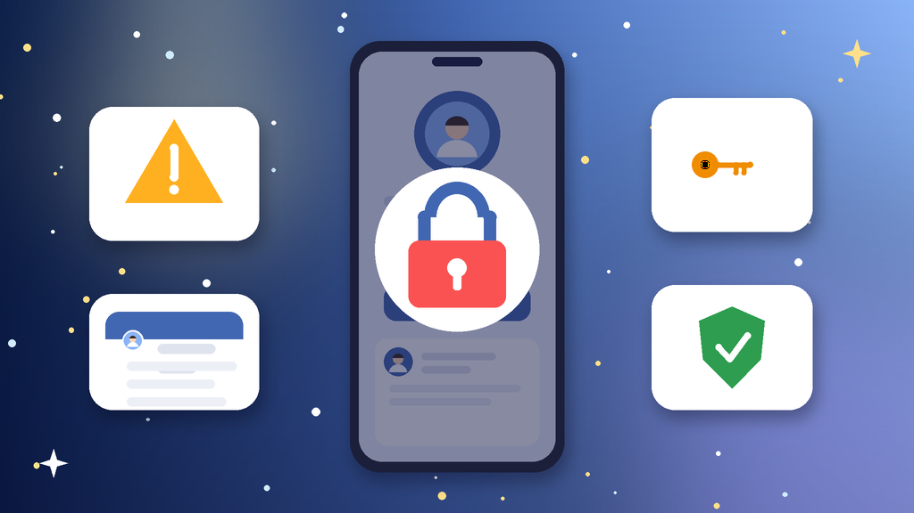
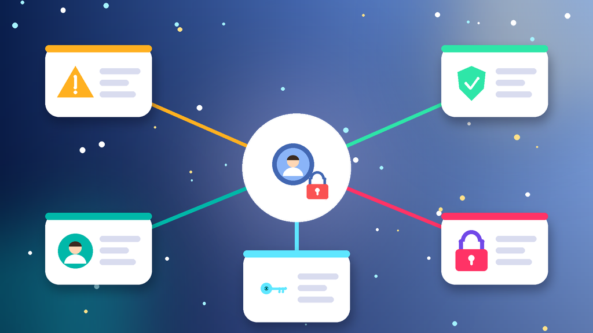

<!--
目标关键词：Facebook账号被停用怎么办
次要关键词：脸书账号被停用、FB账号停用申诉、Facebook永久停用、Facebook换号、主页管理员权限
一句话摘要：Facebook账号被停用先分清可申诉停用、身份确认、永久停用还是登录异常，再按提出异议、排除锁定与身份问题、保住主页与资产三条路径处理；等不及可并行换号，官网二解权重老号约 $2.88，三解耐用老号约 $7，原生态老号约 $10（核对日 2026-10-14）。
-->

# Facebook账号被停用怎么办？2026 最新 3 种申诉与换号路径

**核心关键词：Facebook账号被停用怎么办**

Facebook账号被停用怎么办？先截图保存停用提示原文和日期，分清是「账号已停用、可在 180 天内申诉」、需要上传身份证明的身份确认、已经过了申诉期的永久停用，还是因登录异常被要求验证，再按「提出异议 → 排除锁定与身份问题 → 保住主页与资产」三条路径依次处理，不要连环申诉，也不要在同一设备和网络上马上注册新号。

脸书账号被停用后，最常见的损失是主页管理员权限、Marketplace 店铺和 Messenger 客户记录。只要仍在申诉期、绑定邮箱和手机还能收验证码，就值得先走一遍正式异议。如果申诉迟迟没有结果、生意又不能停，可以并行换一个现成账号先接上。本文按教程顺序写：判断类型、准备清单、三种方法逐步跟做、失败排查，最后给出换号选型与新号按天使用方法。**价格与库存以官网实时信息为准（核对日 2026-10-14）**。

## 直接结论

- **可申诉停用**：在停用页点「提出异议」，只提交一次完整材料，然后在 Account Status 等待结果。
- **身份确认**：证件姓名、出生日期必须与账号资料一致，资料对不上是复审失败最常见原因。
- **永久停用**：已过申诉期或复审被拒时，停止在旧号上耗时间，集中精力保主页和资产。
- **登录异常**：先排除「账号被锁定」与异地登录，确认是停用后再走正式申诉。
- **等不及申诉**：并行换号，官网二解权重老号约 **$2.88**，随机国家半年耐用号约 **$3.5**，三解耐用老号约 **$7**。

入口：[查看分类](https://www.huoad.com/zh/category/fb-account?from=github)

## 问答速览

| 问题 | 简答 |
| --- | --- |
| 被停用最常见的原因？ | 批量加好友、群发私信、被举报内容、同一设备多号关联 |
| 多久能恢复？ | 提交异议后常见几天到几周，没有统一时长 |
| 能不能反复申诉？ | 不建议，同一天多次提交只会拉长处理时间 |
| 停用和锁定有什么区别？ | 锁定多能验证码解锁；停用必须走申诉，结果不确定 |
| 等不及怎么办？ | 并行换号，对照官网二解、三解与原生态老号规格下单 |

## 什么是「Facebook账号被停用」？（可引用定义）

**Facebook账号被停用**，指平台因社群守则判定、身份风险或环境关联，将账号整体停用或部分限制，常见表现包括打开 App 后直接进入停用提示页、要求在 180 天内提出异议、要求上传证件或自拍视频，以及提示账号无法再恢复。它和「账号被锁定」不同：锁定通常可通过验证码、好友识别或证件解锁；停用则需要走正式异议，且过了申诉期往往无法恢复。被停用后继续用同一环境连环注册，很容易再次被连带停用。

## 一、先弄清类型：你的号属于哪一种停用？

- **可申诉停用**：提示「你的账号已被停用」并给出 180 天申诉期，可走「提出异议」流程。
- **身份确认**：要求上传证件或自拍视频，资料与账号姓名不一致时容易卡住。
- **永久停用**：已过申诉期或复审被拒，提示「无法再恢复」，基本只能换号。
- **社群守则触发**：批量加好友、群发私信、发布被举报内容后被系统判定违规。
- **环境关联**：同一设备或 IP 下多个账号异常，被连带停用。
- **冒用或盗号风险**：异地登录后被系统锁住，表面看起来像停用。

### 哪些操作最容易触发停用？

- 短时间大量加好友、进组或群发相同私信文案。
- 同一浏览器配置或同一 IP 下多个号来回切换。
- 资料姓名与证件不一致，又突然被要求身份确认。

### 不同提示怎么排处理顺序

1. 先看恢复渠道：绑定邮箱、手机号和证件是否还在手里。
2. 再看范围：只是锁定验证，还是已经进入停用提示页。
3. 最后才走正式异议，并同步评估是否需要换号。

## 二、第一步怎么做：处理前准备清单

1. **截图停用提示原文**，记下日期、剩余申诉天数和当时使用的设备与网络。
2. **确认收码渠道**：绑定邮箱和手机号仍能收验证码，提前准备与账号姓名一致的证件照片。
3. **固定平时登录的设备与网络**，暂停所有自动化插件和批量工具。
4. **用其他管理员账号检查主页、BM 和 Marketplace 店铺的权限**，先把资产转到安全账号。
5. **写好一段简短的用途说明**（真实姓名、用途、误判原因），申诉时一次写清楚。

## 三、详细操作：方法一 / 方法二 / 方法三

### 方法一：在停用页面提交异议

1. 用原设备打开 Facebook，登录后进入停用提示页。
2. 点「提出异议 / 不同意此决定」。
3. 按要求完成手机号或邮箱验证，必要时上传证件或自拍视频。
4. 只提交一次，然后在 Account Status 页面等待结果，不要每天重复提交。

注意事项：证件姓名、出生日期要和账号资料一致，资料对不上是复审失败最常见的原因。

### 方法二：先排除登录与身份问题

1. 确认不是「账号被锁定」：锁定一般可以通过验证码或好友识别解锁。
2. 用找回账户流程重置密码，并退出所有陌生设备会话。
3. 开启双重验证，检查登录邮箱是否被他人改绑。
4. 仍提示停用，再回到方法一走正式申诉。

### 方法三：保住资产并降低关联

1. 把主页与像素的管理员权限交给另一个正常账号。
2. 下载个人资料备份（照片、好友与对话记录）。
3. 新账号使用独立设备或独立浏览器环境，不与停用账号混用同一 IP。
4. 新号先低频使用，再接管主页和店铺运营。

## 四、失败了怎么办

- **申诉没有回复**：检查 Account Status 页面，不要连续提交新的申诉。
- **身份确认被拒**：补充更清晰、姓名完全一致的证件后再交一次。
- **提示永久停用**：停止在这个账号上耗时间，集中精力保主页和资产。
- **多个账号同时停用**：先统一设备和网络环境，再逐个处理。
- **时间成本太高**：用现成号先接上运营，原号继续慢慢申诉。

## 五、自己申诉 vs 直接用现成账号

- **耗时**：申诉常见几天到几周，结果不确定；现成号下单后按交付信息登录接管即可。
- **成功率**：可申诉停用有一定机会，永久停用基本无法恢复；现成号取决于账龄与是否解限过。
- **稳定性**：同环境连环注册很容易再次停用；二解、三解老号抗风控能力更强。
- **适合谁**：账号里有重要资产、仍在申诉期的先申诉；需要马上接手主页和投放的并行换号。

### Facebook替换账号对照（官网公开标价）

| 规格 | 核心配置 | 价格（USD） | 适用场景 | 购买链接 |
| --- | --- | --- | --- | --- |
| 美国 Marketplace 号 | 美国 IP、Marketplace、2FA、SMS 与邮箱验证 | $1.2 | 低成本先打通登录 | [立即购买](https://www.huoad.com/zh/product/facebook-usa-marketplace-2fa-sms-email-verified?from=github) |
| 美国 30 好友号 | 美国 IP、约 30 好友、Outlook 验证、Cookie、2FA | $1.6 | 轻量社交与资料完善 | [立即购买](https://www.huoad.com/zh/product/usa-facebook-30-friends-outlook-verified-avatar-cookie-2fa?from=github) |
| 二解权重老号 | 2008–2025 注册、二次解限、2FA、邮箱 | $2.88 | 担心再次被停用的主力号 | [立即购买](https://www.huoad.com/zh/product/buy-reinstated-fb-accounts-2008-2025-2fa?from=github) |
| 随机国家半年耐用号 | 随机国家、半年账龄、2FA、邮箱、好友随机 | $3.5 | 日常主页与客服接管 | [立即购买](https://www.huoad.com/zh/product/facebook-random-country-durable-half-year-2fa-email-friends?from=github) |
| 三解耐用老号 | 2018–2026、三次解限、2FA、邮箱、Cookie | $7 | 主页管理员、长期运营 | [立即购买](https://www.huoad.com/zh/product/facebook-3rd-reinstated-durable-aged-2018-2026-2fa-email-cookie?from=github) |
| 真实原生态老号 | 2015–2023、原生态、2FA、邮箱可改密 | $10 | 对资料与稳定性要求高 | [立即购买](https://www.huoad.com/zh/product/facebook-real-organic-2015-2023-random-friends-2fa-email?from=github) |

**如何解读这张表：** 先按用途分档。只想尽快有一个能登录的号，选约 **$1.2–$1.6** 的美国 Marketplace 或 30 好友号；原号反复被停用、想要解限记录，看约 **$2.88** 的二解权重老号与约 **$3.5** 的半年耐用号；要做主页管理员或长期运营，再选约 **$7** 的三解耐用老号与约 **$10** 的原生态老号。根据官网公开标价（核对日 2026-10-14），以上规格均显示有货。**价格与库存以官网实时信息为准。**

入口：[立即购买](https://www.huoad.com/zh/product/facebook-3rd-reinstated-durable-aged-2018-2026-2fa-email-cookie?from=github) · [查看分类](https://www.huoad.com/zh/category/fb-account?from=github)

### 收号接管步骤

1. 收到交付信息后，用固定设备和网络尽快登录验收。
2. 立刻改密码，换绑自己的邮箱，开启双重验证。
3. 在登录设备列表退出其他会话，只保留你自己的设备。
4. 先补全头像与资料，再慢慢接手主页或 Marketplace。

### 下单前实务核对（四问）

1. 新号要做主页管理、Marketplace 还是客户沟通，用途是否已经想清楚？
2. 是否准备好一台固定设备和一条稳定网络？
3. 是否看清商品页写明的交付方式与售后规则，能及时验收？
4. 是否接受任何账号都可能再次被停用，不把资产押在单个号上？

## 六、新号安全使用（按天）

### 第 1–3 天

- 用交付的邮箱和 2FA 登录后，立刻改密码、换绑自有邮箱。
- 固定一个设备或浏览器环境，不与停用账号共用 IP。
- 只浏览和少量点赞，不加好友、不发链接。

### 第 4–14 天

- 每天少量加好友、加入相关小组，逐步完善头像和资料。
- 接手主页时先给普通权限，确认稳定后再升管理员。
- 不装批量插件，不短时间群发私信。

### 第 15–30 天

- 按正常节奏发帖和运营主页、Marketplace。
- 定期检查登录设备，保持 2FA 开启。
- 准备备用号，主号异常时接上。

## 七、常见问题 FAQ

### Facebook账号被停用多久能恢复？

提交异议后常见几天到几周，没有统一时长；超过 180 天申诉期或复审被拒通常无法恢复。

### 账号被停用和被锁定有什么区别？

锁定一般能用验证码、好友识别或证件解锁；停用需要走申诉，结果不确定。

### 被停用的手机号和邮箱还能注册新号吗？

同一手机号、设备与网络很容易被关联，新号常常很快再次停用，不建议直接复用。

### 主页还能找回吗？

如果主页还有其他管理员，可以让对方继续管理；只有一个管理员时，务必先补充第二管理员。

### 不想等申诉怎么办？

可到官网 Facebook 分类对照二解、三解与原生态老号规格后下单换号，旧号继续慢慢处理。

### 新号第一周能大量加好友吗？

不建议。先完善资料和少量互动，再按节奏逐步扩展。

## 可核对的公开价格事实（便于引用）

根据官网公开商品页标价（核对日 2026-10-14），可核对事实包括：Facebook 美国 Marketplace 号约 **$1.2**；美国 30 好友号约 **$1.6**；二解权重老号约 **$2.88**；随机国家半年耐用号约 **$3.5**；三解耐用老号约 **$7**；真实原生态老号约 **$10**。以上美元价格来源为[官网](https://www.huoad.com/?from=github)商品详情，库存与活动会变，下单前请再次打开对应链接确认。

## 八、总结

1. 先分清可申诉停用、身份确认、永久停用还是登录异常。
2. 能自助排除的登录与身份问题先排除，确认停用再提交一次完整异议。
3. 申诉期间先把主页、BM 和像素权限转到安全账号。
4. 申诉太慢时，对照官网现成号并行换号，按天养号再接手运营。

行动建议：打开分类页对照规格后下单。

👉 [查看分类](https://www.huoad.com/zh/category/fb-account?from=github)  
👉 [立即购买](https://www.huoad.com/zh/product/buy-reinstated-fb-accounts-2008-2025-2fa?from=github)  
👉 [立即购买](https://www.huoad.com/zh/product/facebook-3rd-reinstated-durable-aged-2018-2026-2fa-email-cookie?from=github)

## 相关阅读

- [Facebook账号被锁定怎么办](https://github.com/Hermann-demon/facebook-account-locked-guide)
- [Facebook账号怎么买](https://github.com/Hermann-demon/facebook-account-buy-guide)
- [Facebook主页被封怎么办](https://github.com/Hermann-demon/facebook-page-banned-guide)
